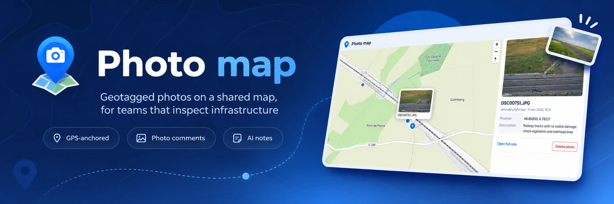
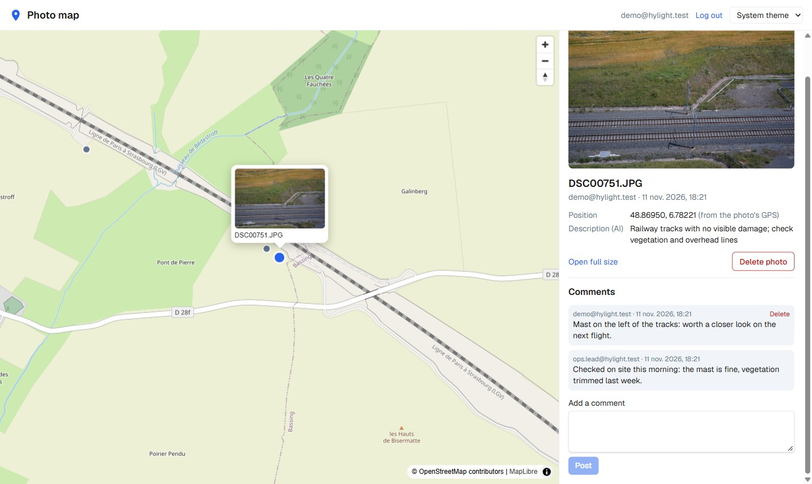
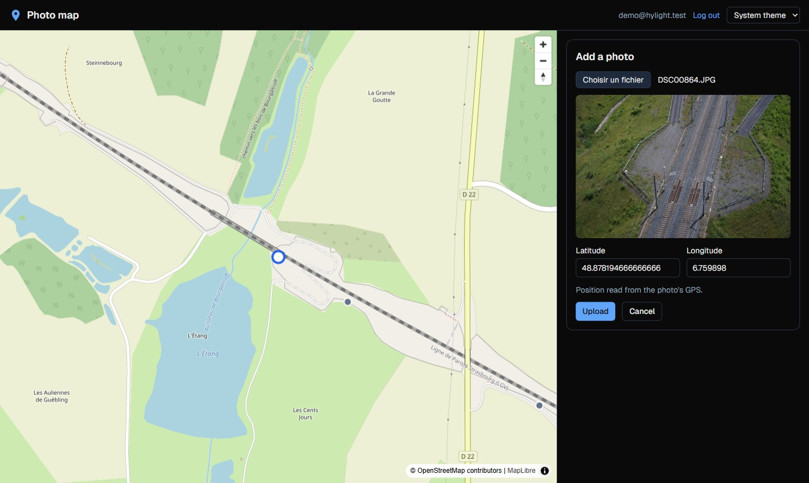
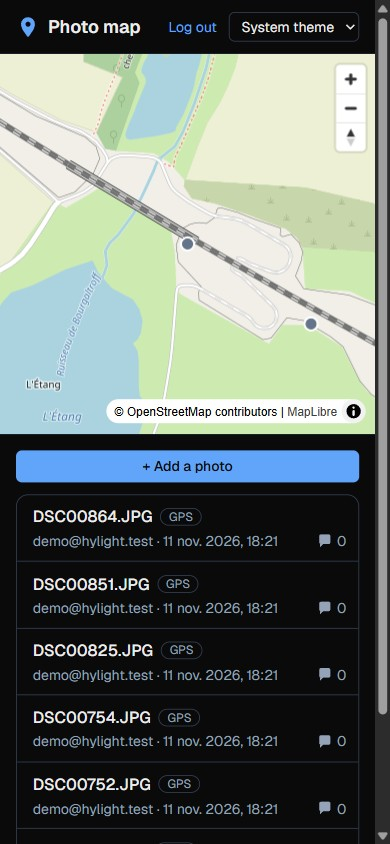

<p align="center">
  
</p>

<p align="center">
  <a href="#run-it">Run it</a> · <a href="docs/STRATEGY.md">Production plan</a> · <a href="docs/DECISIONS.md">All decisions</a> · <a href="#what-id-do-next">What I'd do next</a>
</p>

Upload the photos taken during a flight and they land where they were taken: the **GPS position is read from the photo itself** and shown as a pin before anything is sent, and it can be typed by hand when a photo has none. The whole team sees the same map, opens a photo in one click and **discusses it in comments**. With an Amazon Bedrock key, each new photo also gets a **short inspection note** written by a vision model.

It is a small full-stack app that keeps the important parts in plain sight: **plain SQL** with the rules enforced by the database, **authentication written by hand** with `node:crypto`, and the core rule as **one pure function, written test-first**.

<p align="center">
  
</p>

## What you can do

- **Add a photo.** Pick a JPEG and its GPS position appears as a pin on the map. No GPS, or 0,0? Type the position. The same file cannot be uploaded twice.
- **Find it on the map or in the list.** Selecting a photo flies the map to it, shows a card above its marker and opens the side panel: the image, who uploaded it and when, where it was taken (from its GPS or by hand) and the AI note.
- **Talk about it.** Comment on any photo. Delete your own photos and comments, never someone else's.
- **Use it anywhere.** Light, dark or system theme. Map and panel side by side on a wide screen, stacked on a phone.

<p align="center">
  
  &nbsp;
  
</p>

## Run it

You need Node 20 or newer, and Docker Desktop running.

```sh
npm install      # also copies the MapLibre worker into public/
npm run setup    # starts PostgreSQL on port 15432, runs the migrations, adds the demo account
npm run dev      # http://localhost:3000
```

Log in as `demo@hylight.test` / `hylight-demo`, or create an account. The database starts empty: upload the geotagged photos provided with the brief.

```sh
npm run check    # type check, lint and tests (the tests use the database from npm run setup)
npm run db:reset # start again from an empty database
```

> [!NOTE]
> The AI note is optional and off by default. To turn it on, copy `.env.example` to `.env` in the folder you run the app from, set `AWS_BEARER_TOKEN_BEDROCK` to an Amazon Bedrock API key (and `BEDROCK_MODEL_ID` to a vision model your key can use), then restart `npm run dev`. Without a key, uploads work the same, without a note.

## How it's built

**Next.js 16** (App Router, React, TypeScript, Tailwind) serves the page and a small REST API. Every route checks the session itself and validates its input with **zod**, and all SQL lives in `lib/*-repo.ts`. **PostgreSQL 17** runs in Docker with plain SQL migrations, no ORM. The map is **MapLibre** on OpenStreetMap tiles. The tests use **Vitest** and call the route handlers directly, against the real database.

```
app/api/            the REST routes: auth, photos, photo files, comments
components/         PhotoApp (the screen), PhotoMap, PhotoList, PhotoDetail, UploadForm, Comments, LoginForm
lib/location.ts     the core rule: one valid position per photo, from its GPS or typed by hand
lib/*-repo.ts       every SQL query, one file per table
lib/storage.ts      the only code that knows where photo files live (the one file to swap for S3)
lib/ai.ts           the optional Bedrock call
db/migrations/      the schema, with its checks and constraints
docs/               the production plan, every decision, the screenshots
```

### Data model

```
users     id, email (unique, lowercase), password_hash ("scrypt$salt$hash"), created_at
sessions  id (SHA-256 of the cookie token), user_id -> users (cascade), created_at, expires_at
photos    id, user_id -> users, storage_key (unique, "<uuid>.jpg"), sha256 (unique),
          original_name, lat, lng (in range, not 0,0), location_source ('exif' or 'manual'),
          description (AI, at most 2000 characters, may be empty), created_at
comments  id, photo_id -> photos (cascade), user_id -> users,
          body (trimmed, 1 to 1000 characters), created_at; index (photo_id, created_at)
```

Derived, not stored: the comment count (a subquery), the uploader's email (a join) and the map's GeoJSON (built in the browser from the list), so none of them can go out of date.

### API

Every route except signup, login and logout answers `401` without a session (logout answers `204` either way).

| Method | Path | Body | Returns |
|---|---|---|---|
| POST | `/api/auth/signup` | `{ email, password }` | `201` + session cookie, `400`, `409` email taken |
| POST | `/api/auth/login` | `{ email, password }` | `200` + session cookie, `400`, `401` (same answer for a wrong password and an unknown email) |
| POST | `/api/auth/logout` | | `204`, session deleted |
| GET | `/api/auth/me` | | `200 { id, email }` |
| GET | `/api/photos` | | `200`, newest first, with uploader and comment count |
| POST | `/api/photos` | multipart: `file`, `lat`, `lng`, `locationSource`, optional `preview` | `201`, `400`, `409` same file, `413` over 15 MB, `415` not a JPEG |
| GET | `/api/photos/:id/file` | | `200` JPEG, `400`, `404` |
| DELETE | `/api/photos/:id` | | `204` with its comments and file, `400`, `403` not yours, `404` |
| GET | `/api/photos/:id/comments` | | `200`, oldest first, `400`, `404` |
| POST | `/api/photos/:id/comments` | `{ body }` | `201`, `400` empty or over 1000 characters, `404` |
| DELETE | `/api/photos/:id/comments/:commentId` | | `204`, `400`, `403` not yours, `404` |

## Key decisions

1. **The rules live in the database too.** Positions in range and not 0,0, lowercase emails, trimmed comments, one row per file: zod gives the user a clear 400, and the `check` and `unique` constraints still hold if a future script or endpoint skips zod.
2. **The core rule is one pure function.** `resolveLocation` decides where a photo goes: a position typed by hand wins, otherwise the photo's GPS, and missing, out-of-range or 0,0 GPS counts as none. The browser runs it to pre-fill the form, the server checks the same rule again.
3. **Ownership is checked inside the SQL.** Deletes run `where id = $1 and user_id = $2`, so there is no gap between "is it yours?" and "delete it".
4. **Uploads are never trusted.** Cheapest checks first: size before reading the body, then the fields, then the JPEG signature in the bytes, never the file name. The file is written before the row and deleted if the insert fails, so the map never points at a missing image.
5. **Authentication stays small and readable.** scrypt with a random salt, a random session token whose SHA-256 is the only thing stored, an `httpOnly` `SameSite=Lax` cookie, and the same answer for a wrong password and an unknown email.
6. **No middleware.** In Next 16, `proxy.ts` would buffer every request body and cut it at 10 MB, which would corrupt large uploads without an error, so each route checks the session itself.
7. **The map draws on the GPU.** All photos are one circle layer and the selected one a second layer on top: one draw call for 10k points, where 10k HTML markers would freeze the page.
8. **The AI is a bonus, never a blocker.** Off without a key, capped at 20 seconds, and a failed call only leaves the note empty. In production it would move to a background worker.

Every decision, with its trade-off: [docs/DECISIONS.md](docs/DECISIONS.md).

## What I'd do next

1. **Previews made on the server at upload** (a small and a medium JPEG), used by the list, the side panel, the map card and the AI, instead of the 5 MB original everywhere.
2. **Edit a photo's position** (and regenerate its AI note) instead of deleting and re-uploading it; place a photo by clicking on the map.
3. **The map at scale**: clustering for 10k photos and for close neighbours, loading photos by map area with PostGIS, vector tiles, a tooltip with the name on hover.
4. **Production storage and AI**: S3 with presigned uploads and CloudFront, and the AI note in a background worker so the upload answers at once.
5. **Accounts**: company SSO instead of passwords; until then, a rate limit on login, email verification and a cleanup of expired sessions.
6. **Moderation and duplicates**: let a photo's owner or an admin remove comments, and catch near-duplicates (a resized or re-saved photo) with a perceptual hash.
7. **End-to-end tests in a browser** (Playwright) for upload, comment and delete, run in CI.

## How I worked

- Time spent: about 4 hours, including the production plan in [docs/STRATEGY.md](docs/STRATEGY.md).
- AI tools: I used Claude Code. I reviewed and ran everything, and I made the design decisions above myself.
- Starting point: I started from my own small starter (Docker Compose, a migration runner and a map component) that I prepared to save setup time; everything domain-specific was written during the assessment.
