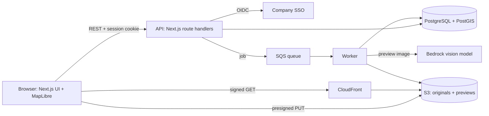

# Strategy: geotagged photos on a map

How I would build this app for real production use. The 4-hour build in this repo follows the same design with a few shortcuts, listed at the end.

## 1. Technology choices

| Part | Choice | Why |
|---|---|---|
| Frontend | Next.js (App Router), React, TypeScript, Tailwind | One codebase for UI and API, types shared end to end |
| Backend | Next.js route handlers (REST) validated with zod, plus a separate worker for slow jobs | Thin handlers, all SQL in one module per table; slow work (previews, AI) never blocks a request |
| Database | PostgreSQL with PostGIS | Constraints and foreign keys in the database; a spatial index for "photos in this map view" |
| Storage | Amazon S3 (private bucket) with presigned uploads, CloudFront for reads | Files never pass through the app server; the database stores only the file key |
| Authentication | Company SSO through OIDC (Microsoft Entra ID or Google Workspace), session in an httpOnly cookie | An internal tool should use the accounts the team already has: no passwords to store, leavers lose access automatically |
| Map | MapLibre GL JS with vector tiles (self-hosted or a provider such as MapTiler) | Open source, GPU rendering, built-in clustering |
| AI | Amazon Bedrock, a vision model in an EU region | Choice of models behind one API, data stays in the EU, called with an IAM role instead of a long-lived key |
| Deployment | AWS: container on ECS Fargate, RDS PostgreSQL, S3, CloudFront, SQS | One cloud and one region, next to Bedrock |

## 2. Architecture

**API**

- `GET /auth/callback`, `POST /api/auth/logout`: SSO login and logout.
- `POST /api/uploads`: returns a presigned S3 URL for a new random key.
- `GET /api/photos?bbox=`, `POST /api/photos`, `GET /api/photos/:id`: list in view, create, details.
- `GET` and `POST /api/photos/:id/comments`.

**Authentication flow**

1. A user without a session is sent to the company SSO.
2. The SSO redirects back to `/auth/callback` with a code. The API exchanges it, finds or creates the user by email, stores a session row and sets an httpOnly, Secure, SameSite=Lax cookie.
3. Every API route looks the session up and answers 401 if it is missing or expired. Sessions live in the database, so logout and revocation take effect at once.

**Data model**

- `users`: id, email (unique), name, created_at.
- `sessions`: id (hash of the cookie token), user_id, expires_at.
- `photos`: id, user_id, storage_key, sha256 (unique), position (PostGIS point, GiST index), location_source (`exif` or `manual`), taken_at, description, description_status (`pending`, `done`, `failed`), created_at.
- `comments`: id, photo_id, user_id, body (1 to 1000 characters), created_at, index on (photo_id, created_at).

## 3. Data flow: from upload to the map

1. The user picks a JPEG. The browser reads the GPS position from the EXIF metadata and pre-fills it. The user confirms it, or places the photo on the map by hand when it has no GPS (or 0,0).
2. The browser asks `POST /api/uploads` for an upload URL and sends the file straight to S3.
3. The browser calls `POST /api/photos` with the key, the position, its source and the file's SHA-256. The API checks the session, the position and that the object exists, is a JPEG and is under the size limit. A known SHA-256 answers 409. It inserts the row, queues a job and answers 201.
4. The worker checks the SHA-256 against the stored file, makes previews, asks Bedrock for a description and updates the row.
5. The map calls `GET /api/photos?bbox=` for the photos in view (id and position only) and draws them. Clicking a marker or a list row loads the details and comments; the image comes from CloudFront.

## 4. Deployment

- **Local**: PostgreSQL in Docker Compose, `npm run dev`, SQL migrations with `npm run db:migrate`.
- **Cloud**: GitHub Actions runs the type check, lint and tests on every pull request. On merge it builds a container image, runs the migrations and deploys to ECS Fargate. RDS with automatic backups, S3 versioning, secrets in AWS Secrets Manager, logs and alarms in CloudWatch. Separate staging and production environments.

## 5. Storing the images: trade-offs

| Option | For | Against |
|---|---|---|
| In PostgreSQL (`bytea`) | One backup, saved in the same transaction as the row | The database grows by gigabytes, every image read goes through it, costly to scale |
| On the app server's disk | Simplest | Lost when the server is replaced, no second server, no CDN |
| Object storage (S3) | Cheap, durable, no size limit, CDN in front, uploads skip the app server | One more service; the bucket and the database can drift apart, so a periodic job removes orphan files |

**Choice: S3.** Keep the original (the ops team may need full detail) plus previews made by the worker: about 400 px for lists, 1600 px for the side panel and the AI. The bucket is private and reads use signed URLs, because operation photos are not public and the original still contains its GPS metadata. A lifecycle rule moves old originals to a cheaper storage class.

## 6. Keeping the map fast with 10k photos

- **GPU layer, not HTML markers.** A circle layer on a GeoJSON source draws 10k points in one pass; 10k HTML markers (one element and one image each) freeze the page.
- **Clustering.** MapLibre groups points that are close on screen and shows a count; clusters split as you zoom in. Two photos 4 m apart stay grouped until the zoom can separate them.
- **Send only what the map needs.** Id and position are about 30 bytes per photo, roughly 300 KB for 10k before compression. Details, comments and the image load only for the selected photo.
- **Previews, never originals,** in lists and panels.
- **Beyond about 100k photos:** load only the visible area (`bbox` query on the PostGIS index) or serve vector tiles from PostGIS (`ST_AsMVT`), and paginate the list.

## 7. Time estimate (one developer, production quality)

| Step | Estimate |
|---|---|
| Setup: repository, CI, environments, infrastructure as code | 2 days |
| Backend: schema, API, uploads, worker | 4 days |
| Frontend: layout, list, side panel, forms | 4 days |
| Authentication: SSO, sessions | 2 days |
| Map integration: markers, clustering, selection, placing by hand | 3 days |
| AI: Bedrock call, prompt, check on sample photos | 2 days |
| Testing: unit, API, end to end | 3 days |
| Deployment: AWS, monitoring, backups | 3 days |
| **Total** | **23 days, about 5 weeks with reviews and contingency** |

## 8. What the 4-hour build does differently

- **Email and password** (scrypt from `node:crypto`, sessions in the database) instead of SSO, because there is no SSO tenant to set up in 4 hours. The email format is checked; ownership is not (no verification email).
- **Uploads go through the API** (multipart) to a local `uploads/` folder behind `lib/storage.ts`, instead of presigned S3 uploads. Moving to S3 means rewriting that one file.
- **Latitude and longitude columns** instead of PostGIS, and all photos loaded at once instead of by bounding box.
- **No worker:** if there is time, the AI description runs with Next.js `after()` once the upload has answered.
- **No deployment:** runs locally with Docker.
